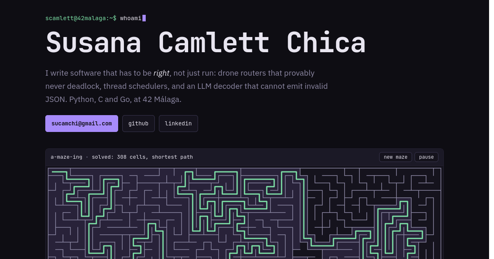

# Susana Camlett Chica · Professional portfolio

[](https://sucamchi.github.io/portfolio/)
[](tests/sim.test.mjs)
[](#how-its-built)
[](LICENSE)

[](https://sucamchi.github.io/portfolio/)

Most of my projects are command-line programs: a drone router, a thread
scheduler, an LLM decoder. You can't click on a CLI from a portfolio, so
instead of screenshots this site **runs the algorithms themselves in your
browser**, as small JavaScript ports of the real code.

**[sucamchi.github.io/portfolio](https://sucamchi.github.io/portfolio/)**

## The demos

| Demo | What you see | Ported from |
| --- | --- | --- |
| Maze (hero) | A maze carved by depth-first search with an explicit stack, then solved by breadth-first search | [A-Maze-ing](https://github.com/sucamchi/A-Maze-ing) (Python) |
| Constrained decoding | An LLM building a JSON function call token by token, with every invalid token masked to `-inf` | [CallMeMaybe](https://github.com/sucamchi/CallMeMaybe) (Python) |
| Drone routing | 8 drones routed by one backwards Dijkstra pass and a nearest-first move order that can't deadlock | [Fly-in](https://github.com/sucamchi/Fly-in) (Python) |
| Dining coders | 5 coder threads sharing dongles, with lock ordering, FIFO or EDF scheduling and a live burnout limit you can drag | [Codexion](https://github.com/sucamchi/Codexion) (C, pthreads) |
| Occupancy chart | Ten years of Costa del Sol hotel occupancy from the INE dataset, COVID crash included | [OcupaSol](https://github.com/sucamchi/OcupaSol) (Python + JS) |

The decoding demo replays a scripted run: the token splits and scores are
illustrative, the masking rules are the real ones. The other demos compute
everything live.

## How it's built

Plain HTML, CSS and JavaScript modules. No framework, no bundler, no build
step, nothing to install. GitHub Pages serves the repository as it is.

- **The routing and threading rules are kept apart from the drawing.**
  `js/flyin-sim.js` and `js/codexion-sim.js` have no DOM code, so the same
  files that run in the page are tested under Node.
- **Demos only run while they're on screen.** `loopWhileVisible()` in
  `js/canvas.js` stops a canvas's animation loop as soon as it scrolls away.
- **One palette.** The canvas demos read their colours from the CSS custom
  properties in `style.css`, so the page and the drawings can't drift apart.
- **Accessible by default.** Every demo can be paused, canvases carry text
  descriptions, and with `prefers-reduced-motion` the maze appears already
  solved, drones jump instead of gliding, and nothing types itself out.
- **The look** is a terminal session: every section opens with a shell
  prompt, and the navigation is a tmux status bar that tracks where you are.

## Run it locally

ES modules don't load from `file://`, so serve the folder:

```bash
git clone https://github.com/sucamchi/portfolio.git
cd portfolio
python3 -m http.server 8000      # then open http://localhost:8000
```

Run the tests (Node 18 or later):

```bash
node --test
```

They check that every drone is delivered without ever overfilling a zone
or stalling a turn, that a compiling coder always holds both of its dongles,
and that the default Codexion settings never burn out under either
scheduler while a tight limit always does.

## Layout

```
index.html            the whole page
style.css             palette, layout, the tmux status bar
js/
  main.js             status bar, clock, hero prompt
  canvas.js           shared helpers: sharp canvases, on-screen-only loops
  maze.js             hero maze (DFS + BFS)
  decode.js           constrained decoding replay
  flyin-sim.js        Fly-in routing rules (no DOM, tested)
  flyin.js            Fly-in drawing
  codexion-sim.js     Codexion simulation (no DOM, tested)
  codexion.js         Codexion drawing and controls
  chart.js            OcupaSol chart, data embedded
tests/sim.test.mjs    node --test suite for the two simulations
assets/preview.png    link preview image
```

## Contact

[sucamchi@gmail.com](mailto:sucamchi@gmail.com) ·
[LinkedIn](https://www.linkedin.com/in/scamlett) ·
[GitHub](https://github.com/sucamchi)

Code is [MIT licensed](LICENSE).
